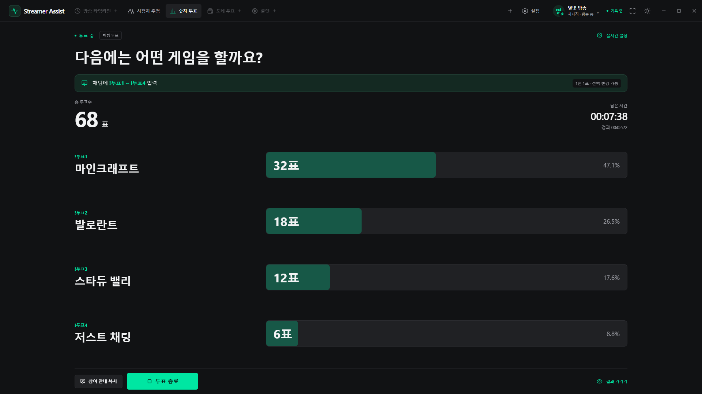
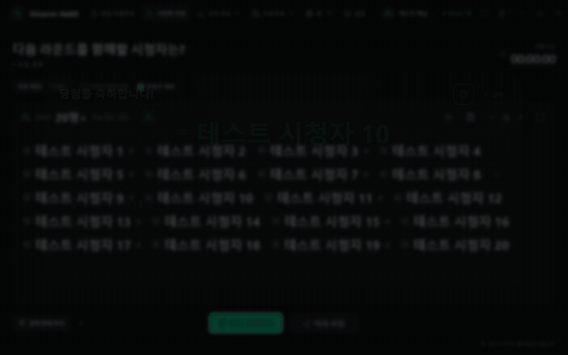
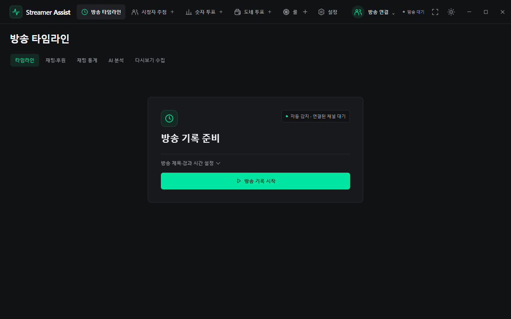
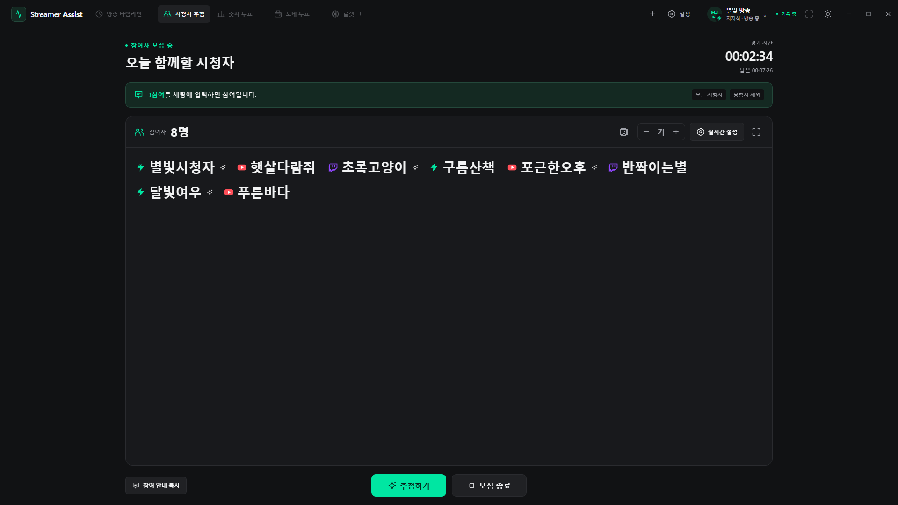
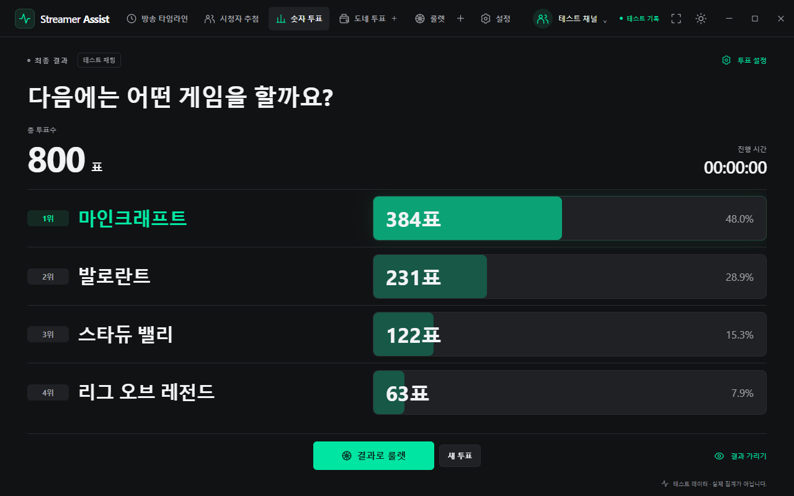
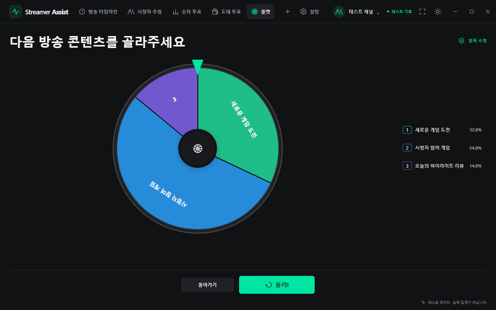
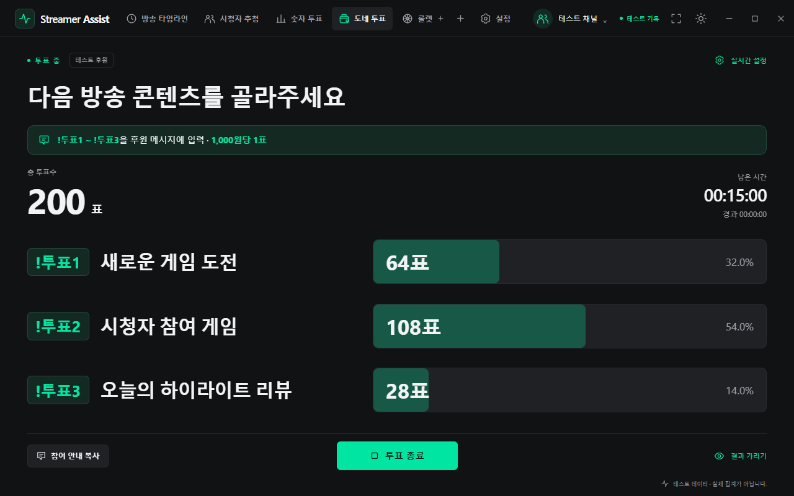
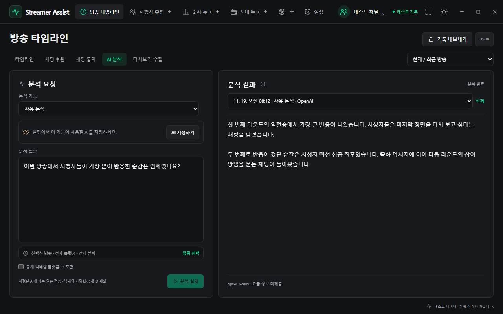

<div align="center">
  
  <h1>Streamer Assist</h1>
  <p>치지직·YouTube·Twitch의 방송 채팅을 기록하고, 추첨·투표·룰렛을 진행하는 Windows 앱.</p>
  <p>
    <a href="https://github.com/yechankun/streamer-assist/actions/workflows/ci.yml"></a>
    
    <a href="LICENSE"></a>
  </p>
  <p><a href="README.md">English</a> · <strong>한국어</strong></p>
  <p><a href="#시작하기">시작하기</a> · <a href="#제품-화면">제품 화면</a> · <a href="docs/user-guide.ko.md">사용 가이드</a></p>
  <picture>
    <source media="(prefers-color-scheme: light)" srcset="docs/assets/screenshots/live-poll-light.png">
    
  </picture>
  <p><sub>v0.4.11에서 샘플 데이터로 촬영한 화면입니다.</sub></p>
</div>

## 주요 기능

- **방송 기록** — 채팅·후원·시청자 수를 모으고, 단축키로 다시 보고 싶은 순간을 남깁니다.
- **시청자 참여** — 시청자를 추첨하고 숫자 투표·지원 후원 투표·가중치 룰렛을 진행합니다.
- **방송 돌아보기** — 채팅을 검색하고 반응 통계를 확인합니다. 원하면 연결한 AI로 선택한 기록을 분석합니다.

도구를 여러 탭·창에 나눠 놓고 글자 크기를 조절할 수 있습니다.

F11이나 버튼으로 전체화면을 사용할 수 있습니다. 추첨 명단은 플랫폼 아이콘과 함께 이름 길이에 따라 이어지고 −/+로 크기를 조절합니다. 이름을 눌러 해당 시청자의 공개 채팅을 모아 봅니다. 명단 위 스피커로 시청자·당첨자 새 채팅 자동 읽기를 켜고 끄며, 채팅창의 스피커도 같은 설정을 저장합니다. 얼굴 아이콘으로 의상·색상을 조합한 픽셀 캐릭터와 말풍선 표시를 켤 수 있으며 선택은 저장됩니다. 캐릭터는 작게 숨쉬는 대기 모션을 표시합니다. 슬롯머신·룰렛·당첨 축하 연출은 **설정 → 일반 → 추첨·룰렛 연출**에서 별도로 켜고 끕니다. 채팅 읽기를 켜면 당첨 직전 마지막 채팅을 한 번 읽고 새 채팅을 이어서 읽습니다. 모집 종료 후 명단을 유지하려면 ‘모집 재개’, 비우려면 ‘추첨 초기화’를 누르세요. [v0.4.12 변경 내용](docs/releases/v0.4.12.md)


**설정 → 방송 기록**에서 실시간 저장·종료 후 분석·다시보기 수집을 선택할 수 있습니다. 제공되는 Twitch·치지직 VOD 채팅을 영상별로 합칩니다. YouTube는 모든 방식에서 공식 API로 수신한 실시간 원본을 저장하며 종료 후 전체 채팅 수집은 지원하지 않습니다. 실시간 시청자 수·참여 기능은 유지합니다. [수집 방식·공식 사후 조회 범위](docs/timeline-data.ko.md)를 확인하세요.

## 시작하기

**Windows 10/11 x64**에서 사용합니다. [GitHub 릴리즈](https://github.com/yechankun/streamer-assist/releases/latest)에서 설치 파일과 해당 버전의 변경 내용을 확인하세요. 현재 개발 프리뷰입니다.

계정 없이 먼저 체험할 수 있습니다.

1. **방송 타임라인 → 방송 기록 시작**을 누릅니다.
2. **설정 → 일반 → 테스트 채팅**을 켭니다.
3. **시청자 추첨**, **숫자 투표** 또는 **룰렛**을 열어 봅니다.

테스트 채팅은 샘플 메시지를 만들며 실제 결제나 투표 게시를 하지 않습니다. 실제 방송을 연결하려면 **설정 → 플랫폼 연결**을 사용하세요. [사용 가이드](docs/user-guide.ko.md)에서 이어서 안내합니다.

<details>
<summary>소스에서 실행하기</summary>

Node.js 22 이상이 필요합니다.

```powershell
git clone https://github.com/yechankun/streamer-assist.git
cd streamer-assist
npm ci
npm run dev
```

빌드·검사·OAuth 설정은 [개발 가이드](docs/development.ko.md)를 참고하세요.

</details>

## 제품 화면

이미지를 누르면 원본으로 볼 수 있습니다. 모든 화면은 샘플 데이터로 촬영했습니다.

### 당첨 순간을 함께 즐겨요

폭죽과 흩날리는 색종이로 축하하고, 결과 창에서 당첨자의 채팅 반응을 이어 봅니다.

<picture>
  <source media="(prefers-reduced-motion: reduce)" srcset="docs/assets/demos/winner-celebration.png">
  
</picture>

*v0.4.11에서 테스트 채팅으로 촬영했습니다.*

<table>
  <tr>
    <td width="50%"><a href="docs/assets/screenshots/timeline-ready.png"></a><br><strong>방송 전 타임라인</strong><br>방송 감지 상태를 확인하거나 직접 기록을 시작합니다.</td>
    <td width="50%"><a href="docs/assets/screenshots/viewer-raffle.png"></a><br><strong>시청자 추첨</strong><br>채팅 참여자 중 한 명을 뽑습니다.</td>
  </tr>
  <tr>
    <td width="50%"><a href="docs/assets/screenshots/poll-result.png"></a><br><strong>투표 종료</strong><br>집계가 끝나면 순위와 득표수를 함께 표시합니다.</td>
    <td width="50%"><a href="docs/assets/screenshots/roulette.png"></a><br><strong>가중치 룰렛</strong><br>직접 만든 항목이나 종료된 투표 결과로 돌립니다.</td>
  </tr>
  <tr>
    <td width="50%"><a href="docs/assets/screenshots/donation-vote.png"></a><br><strong>후원 투표</strong><br>시청자는 선택지 옆 명령어를 후원 메시지에 입력합니다.</td>
    <td width="50%"><a href="docs/assets/screenshots/ai-analysis.png"></a><br><strong>AI 분석</strong><br>방송에 대해 질문하고 저장한 결과를 다시 읽습니다.</td>
  </tr>
</table>

[채팅·AI·탭 배치·설정 화면도 보기](docs/assets/screenshots/README.md)

<a id="데이터와-플랫폼-참고"></a>

## 알아두기

- 영상·음성은 녹화하지 않습니다. 하이라이트는 채팅 반응으로 찾는 편집 후보입니다.
- 후원 투표는 지원되는 치지직·YouTube 메시지를 집계합니다. Twitch 기본 투표와 Bits 후원 투표는 지원하지 않습니다.
- 기록은 PC에 암호화해 보관합니다. 내보낸 파일은 일반 파일이며, AI 분석은 사용자가 실행할 때 선택한 기록을 외부 CLI/API에 전달합니다.

플랫폼별 연결 조건과 데이터 관리는 [사용 가이드](docs/user-guide.ko.md#플랫폼과-제한)에서 확인하세요.

## 문서

| 하고 싶은 일 | 안내 |
| --- | --- |
| 방송 연결과 도구 사용 | [사용 가이드](docs/user-guide.ko.md) |
| AI 연결과 채팅 분석 | [AI 가이드](docs/ai-integrations.ko.md) |
| 코드 실행·테스트·빌드 | [개발 가이드](docs/development.ko.md) |

[전체 문서](docs/README.md) · [개인정보처리방침](docs/privacy.html)

## 기여와 라이선스

[의견·문제 제보](https://github.com/yechankun/streamer-assist/issues) · [기여 안내](CONTRIBUTING.md#한국어) · [MIT 라이선스](LICENSE)

NAVER·치지직·YouTube·Twitch와 제휴하지 않은 독립 오픈소스 프로젝트입니다.
