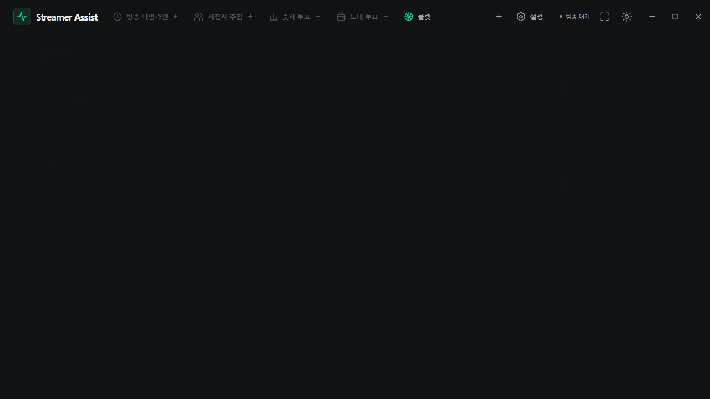

# Streamer Assist v0.4.7

## 한국어

- 숫자 투표·시청자 추첨·도네 투표의 준비 화면을 필수 입력과 시작 버튼 중심으로 정리했습니다. 참여 플랫폼·조건·금액 규칙·자동 종료는 접어서 요약하며, 필요한 오류만 표시합니다.
- 숫자 투표와 도네 투표는 기본 선택지 두 개를 바로 입력하고 최대 네 개까지 추가합니다. 선택 번호를 입력창 안에 표시하며 Enter로 다음 선택지로 이동합니다.
- 룰렛 준비 화면에서 항목·가중치·확률과 실시간 원판 미리보기를 함께 확인합니다. 시작 버튼 이름을 **시작**으로 줄였습니다.
- 미리보기는 약 0.4초 동안 부드럽게 채워지고, 항목 추가·삭제·가중치 변경 시 칸이 늘어나거나 줄어듭니다. 연속 편집도 현재 모양에서 이어지며, 빈 항목·가중치 0은 제외합니다. 비활성·숨김 상태에서는 정지하고 Windows 동작 줄이기를 따릅니다.
- 900 × 650 창, 글자 크기 150%, 두 테마에서 입력·설정·원판 배치를 확인했습니다. 실제 추첨 확률과 방송용 회전·슬롯머신 동작은 유지됩니다.

앱 버전: **0.4.7** · Microsoft Store MSIX 버전: **1.4.7.0**.

*실제 앱에서 샘플 항목을 입력하고 가중치를 바꾸며 캡처한 화면입니다.*

## English

- Simplify numeric poll, viewer raffle and donation poll preparation around required inputs and the start action. Collapse platform, eligibility, price and timer settings into a current-value summary; show actionable errors when needed.
- Begin numeric and donation polls with two editable choices, add up to four, and use Enter to move to the next choice. Keep choice numbers inside their input rows.
- Show roulette entries, weights, probabilities and a live wheel preview together. Rename the setup action to **시작** (Start).
- Animate preview slices over approximately 0.4 seconds as entries are added, removed or reweighted. Rapid edits continue from the current shape. Blank and zero-weight entries are excluded. Preview motion stops while hidden/inactive and respects Windows reduced motion.
- Verify both themes, a 900 × 650 window and 150% text. Selection probabilities and broadcast wheel/slot-reel behavior are unchanged.

App version: **0.4.7** · Microsoft Store MSIX version: **1.4.7.0**.
